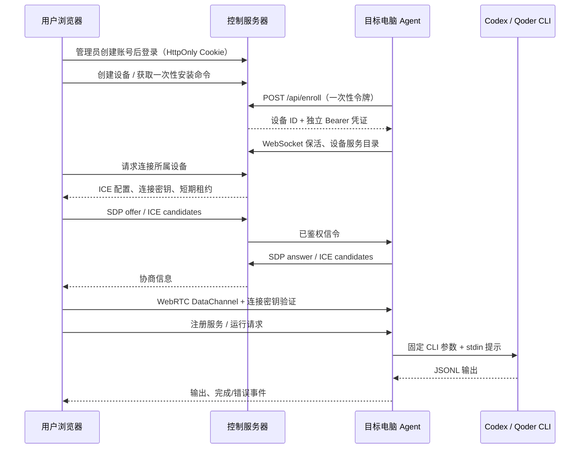
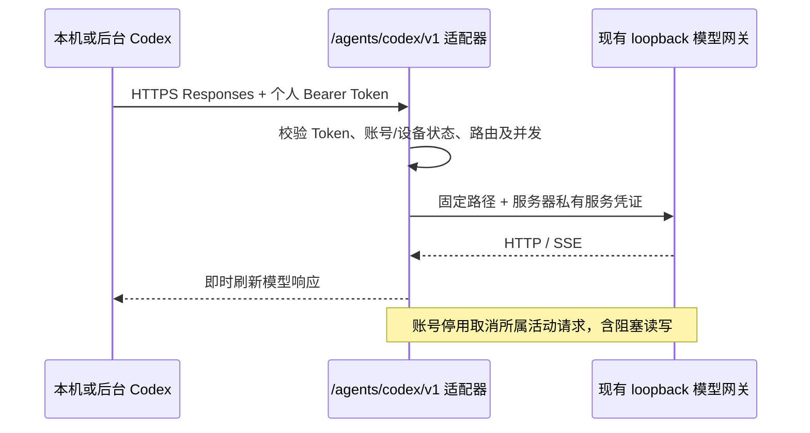

# 架构与协议



WebRTC 通过 ICE 挑选可达路径；必要时 TURN 只中继 DTLS 密文。浏览器远程执行指令和会话输出走此通道，服务器不提供远程任务执行 API。配置平台提供方的 Codex 另走模型 HTTPS 通道，服务器会处理该通道中的模型输入/输出。信令服务器能看到 SDP、IP 候选及连接密钥，仍是可信控制平面。



模型适配器保留现有 139 网关独立运行，不迁移其 OAuth 状态、旧 Token 或 `/openai/personal/v1`。应用库不存模型正文，适配器也不记录请求/响应正文；这不改变服务器对转发中明文模型内容的信任边界。

## HTTP

| 路由 | 身份 | 行为 |
| --- | --- | --- |
| `POST /api/register` | 无 | 始终 `403`；`ALLOW_SIGNUP=true` 也无效 |
| `POST /api/login` | 无 | 登录 |
| `POST /api/logout` | Cookie | 删除当前会话并关闭它创建的直连会话 |
| `GET /api/me`、`GET /api/account` | Cookie | `{id,username,admin,expiresAt}` |
| `PATCH /api/account` | Cookie + 当前密码 | `{username?,currentPassword,password?}`；修改后清 Cookie、失效所有浏览器会话 |
| `GET/POST /api/admin/users` | 管理员 Cookie | `?search=` 搜索；`{username,password,admin}` 创建用户 |
| `PATCH /api/admin/users/{id}` | 管理员 Cookie | `{admin?,disabled?,password?}`；保护最后一名有效管理员 |
| `GET/POST /api/tokens` | Cookie | 列出本人元数据；`{name}` 创建并首次返回 `{token,...metadata}` |
| `DELETE /api/tokens/{id}` | Cookie | 仅撤销本人 Token |
| `GET /api/admin/tokens` | 管理员 Cookie | 列出元数据，可按 `?userId=` 过滤 |
| `DELETE /api/admin/tokens/{id}` | 管理员 Cookie | 撤销任意 Token |
| `GET /api/codex` | Cookie | `{enabled,baseUrl,model}`；默认网关未启用 |
| `GET /api/agents` | Cookie | 仅所属设备及在线状态 |
| `POST /api/agents` | Cookie | `{name}` → 设备、Windows/macOS/Linux 安装命令 |
| `DELETE /api/agents/{id}` | Cookie | 校验归属、撤销和断开 |
| `POST /api/enroll` | 一次性令牌 | `{token,os,arch}` → `{id,name,credential}` |
| `GET /api/agent/connect?id=...` | Bearer | Agent WebSocket |
| `POST /api/agent/codex?id=...` | Agent Bearer | 签发设备专属新模型 Token 并保留旧 Token，返回 `{baseUrl,token,model}` |
| `GET /api/agents/{id}/signal` | Cookie + Origin | 浏览器信令 WebSocket |
| `GET /install/{script}` | 无或一次性绑定令牌 | 设备、`cli-*` 持久 CLI、`codex-*` 交互配置三种模式 |
| `GET /install/codex-release`、`GET /downloads/codex/{file}` | 无 | 服务器转发白名单官方发布元数据/安装包，不接收任意下载 URL |
| `GET /codex/v1/models` | 个人模型 Bearer | 固定上游 `/models` |
| `POST /codex/v1/responses`、`POST /codex/v1/responses/compact` | 个人模型 Bearer | 固定上游 Responses / Compact，HTTP/SSE |

路由均相对 `PUBLIC_URL` 的路径，例如生产部署挂载于 `/agents`。账号/设备 POST 要求 `application/json`，禁止跨来源写请求及跨来源 WebSocket；Cookie 使用 HttpOnly / SameSite=Strict，HTTPS 时 Secure。模型接口只用个人 Bearer，不依赖浏览器 Cookie，并拒绝 Origin / 浏览器 fetch 来源请求。

## 账号、Token 和模型边界

用户 ID 不随重命名变化。用户名去首尾空白、限制 1–64 个 Unicode rune、拒绝控制字符，以 `unicode.SimpleFold` 的稳定代表符号比较；身份索引和部分名称搜索共用同一折叠，`Σ/σ/ς`、`K/K` 等价。密码为 6–72 字节，bcrypt cost 12。修改本人用户名或密码必须验证当前密码，事务内再比较密码快照，避免并发重置后旧校验仍可写入或创建新会话。管理员重置密码同样使原浏览器会话失效，返回值从不包含密码哈希。

首次管理员只通过停止服务器后的离线 `remote-server admin create --username NAME --password-stdin` 或 `admin grant --username NAME` 建立，数据库路径来自 `DATABASE_PATH`；生产已有用户 `string` 已在本次 139 升级中明确 grant，原密码保持不变。角色/停用事务同时重新检查操作者权限和其他有效管理员数，并发降级/停用也不能移除最后一名。停用账号立即阻止登录、会话、设备鉴权、绑定兑换和模型请求，关闭相关 WebSocket 并取消所属活动模型 HTTP 请求；其他账号的连接保持运行。

首次打开旧库会原子迁移 `users` 中按用户名保存的记录到按 ID 保存的 `accounts` 和 `usernames` 唯一索引，`meta` 保存迁移版本。保留原 ID、密码、sessions、agents 和 enrollments；原用户不会自动晋升。归一化冲突中止整个事务。回滚旧二进制时需一起恢复升级前、停止状态复制的数据库，而非直接把旧进程指向新索引。

模型 Token 为 `ra_codex_` 加 32 随机字节的 base64URL；`codex_verifiers` 仅保存 SHA-256 到 Token ID 的映射。`codex_tokens` 保存 `{id,userId,name,prefix,createdAt,lastUsedAt,revoked,agentId?}`。创建时只返回一次秘密，列表只返回元数据。可选 `agentId` 的 Token 必须属于同一用户的有效已绑定设备；设备配置签发新 Token 并保留已有 Token，安装或配置失败不会使原有连接失效，撤销设备同时撤销这些 Token。个人 Token 撤销阻止后续请求；账号停用另有活动请求取消机制。

`CODEX_GATEWAY_URL` 默认为空；设置后必须为字面 loopback IP 的 HTTP 根地址，如 `http://127.0.0.1:8088`，不接受 hostname、公网地址、用户信息、上游子路径或可变目标。服务 Token 在启动时从 `CODEX_GATEWAY_TOKEN_FILE` 读取；`CODEX_MODEL` 默认 `gpt-6.1-sol`。转发只允许模型目录、Responses 和 Compact，关闭环境代理与重定向；只转发明确允许的请求头，替换 Authorization，剥离 Cookie、Proxy-Authorization 和账号路由覆盖，拒绝凭证/账号路由查询参数。下游只得到个人 Token，永远得不到服务凭证。

全实例最多 2 个活动模型请求，满时 `429`；请求体最多 32 MiB，每个请求独立 30 分钟 context 期限。按用户登记取消函数后再次检查账号状态，关闭开始请求与停用之间的竞态。停用/关停会取消上游，并设置 HTTP 响应控制器读写 deadline，中止 HTTP/1 部分上传或下游阻塞写入，释放并发槽位。SSE 每次写入即 flush；取消可能以不完整 chunk/EOF 结束。非成功上游响应使用不含服务秘密的 `{error:{message,type}}`，账号库和日志不保存模型正文。

## 持久本机工具与 Codex 配置

`remote-agent` 本地 CLI 可独立于设备绑定存在。`cli-windows.ps1` / `cli-macos.sh` / `cli-linux.sh` 安装该工具且不启用远程服务，已有绑定和服务启停状态保留。`codex-*` 模式隐藏读取个人模型 Token 后调用 `codex setup --server URL --token-stdin`；设备安装模式用一次性令牌 enroll，再按服务端是否启用网关决定自动配置 Codex。Windows `-NoStart/-SkipCodex`、Unix `--no-start/--skip-codex` 分别控制远程服务和自动配置。

`codex install/update --server URL` 通过平台官方发布转发下载和强制 SHA-256 校验官方 CLI，托管在 `~/.remote-agent/bin`。`setup` 保留已检测到的兼容安装，缺失时补装。App 安装/升级独立调用 Windows Microsoft Store `winget` 或 macOS Homebrew cask `codex-app`；Linux 只支持此处的 CLI 流程。`start` 等同启用匹配的自启动并启动已绑定设备，`stop` 移除对应自启动并停止进程，保留工具、绑定、配置和历史。

Unix 选择完整 `codex-package-*` 官方包，保留 `bin/codex` 与资源目录，并用相对符号链接暴露命令入口；Windows 保留架构主程序及所有辅助文件，`codex.exe` 使用硬链接或复制别名。安装先准备并发布辅助文件，最后替换主入口，失败时恢复原安装。下载期限为 25 分钟；压缩数据限 256 MiB、单文件 512 MiB、总解压量 2 GiB、最多 10000 条，拒绝归档链接、特殊文件和路径穿越。安装生成的 Unix 命令入口符号链接与被拒绝的包内链接分别处理。

配置工具尊重 `CODEX_HOME`，以 TOML 解析/合并 `config.toml`：先写私有 `backup-*`，检测文件是否被并发修改，再原子替换；无效 TOML 不改写。保留已有模型和无关项目/MCP/通知/其他 provider 等设置，仅切换根 provider 及默认选中的 profile，规范化过时 `extrahigh`；其他显式 profile 保持原值。它不改写独立 OAuth 文件。`sunny_agents` provider 的私有 `http_headers.Authorization` 持有个人 Token，设置 Responses、禁用 WebSocket 和 OpenAI 登录要求，使 GUI 与后台进程不依赖终端环境变量。Unix 文件为私有权限，Windows 仅授权用户/SYSTEM；备份也含凭证。

安装脚本的 CLI/Codex 模式更新用户 PATH，设备模式启用 Codex 配置时也更新：Windows 用户 PATH，macOS `.profile/.zshrc`，Linux `.profile/.bashrc`；新终端生效。网页在一次显示 Token 时提供一条复制即可安装/配置的命令，该命令含秘密且可能保存在 shell 历史；交互隐藏输入或私有 stdin 可避免把 Token 写进命令文本。配置后完全重启 App 并新建本地对话，旧对话可能保留旧 provider；平台仅提供模型 API，不代替 ChatGPT 云任务/插件服务。

## 信令

消息格式在 `internal/protocol/protocol.go`。

- Agent 每 20 秒发 `heartbeat` 和服务目录；服务器回复保活确认。
- 浏览器先收到 `ready`：`peerId`、随机 `secret`、`expiresAt`、`iceServers`。
- 浏览器只可发一次 `offer`，然后发送候选。服务器自行填入 peer ID / secret，忽略客户端伪造的路由字段。
- Agent 回 `answer` / `candidate`，服务器仅转发给此设备所属连接。
- 浏览器每 20 秒 `ping`，服务端 `pong`。退出、撤销、掉线时服务端向 Agent 发 `close`。
- 服务端每个读取周期校验会话与设备状态；Agent 强制执行租约到期，信令断开时销毁所有 Peer。

浏览器 / Agent 均允许在 SDP 到达前暂存候选；服务端限制消息大小、候选数量及每设备连接数。设备重新上线替换旧控制连接时也会关闭旧浏览器会话。

## DataChannel

唯一通道名 `remote-agent`，有序可靠传输。首条请求必须为：

```json
{"id":"request-id","type":"authenticate","secret":"per-connection-secret"}
```

认证成功后返回设备的服务列表、检测到的 CLI 和本机授权策略。

| 请求类型 | 字段 | 结果 |
| --- | --- | --- |
| `services.list` | 无 | `services, providers, allowedRoots, allowWrite, sayso, directorySearch` |
| `directories.search` | `path`（可选浏览目录）、`search`（目录名或部分路径） | `directories: [{name,path}], base, parent, separator, recursive, truncated` |
| `services.add` | `service: {name,provider,workspace}` | 规范化服务，随机 ID |
| `services.remove` | `serviceId` | 成功；有运行任务时拒绝 |
| `run` | `serviceId,prompt` | `started` → 多个 `output` → `done` |
| `sayso.call` | `method,path,body` | 目标电脑内的讨论、Action、录音分片操作；不是 HTTP 代理 |
| `cancel` | `runId` | 仅能取消当前 Peer 创建的匹配任务 |

普通应答 `{id,type:"result",data}`，错误 `{id,type:"error",error}`。输出为 `{id,type:"output",data:{stream:"stdout",text:"..."}}`，另有 stderr。任务完成使用 `{id,type:"done",data:{ok:true}}`，失败时附 `error`。

目录搜索仅在已认证 DataChannel 上提供，不经过服务器 HTTP。Agent 对根目录及符号链接规范化后检查 `allowedRoots`，只返回文件夹，不返回文件内容。空查询返回授权根目录和已注册项目；部分路径补全当前层，目录名搜索最多 5 层，跳过依赖、缓存和隐藏目录的递归遍历。每次搜索最多检查 10,000 项、返回 40 项，并在遍历中检查 2 秒期限；达到限制时返回 `truncated`，用户可细化路径或逐层浏览。网页对输入防抖并丢弃过期响应；旧版 Agent 仍可手动填写绝对路径。

运行器只从本机检测结果挑选固定命令，不接受任意 executable、shell 参数或环境变量。提示通过 stdin 传递；浏览器文本不会拼到 shell 命令。Windows 包装 `.cmd/.ps1` 时只引用本机命令路径和固定参数。取消使用 Windows 进程树终止 / Unix 进程组终止。

## 文件与部署边界

本机 `update` 命令复用绑定服务器的 `/downloads/` 路由，无需新的服务器管理接口或设备凭证。下载禁用重定向、不发送凭证，限制安装包大小，校验 SHA-256 并在临时程序上验证 `version`；跨进程文件锁防止重复更新。替换前仅管理与本机安装路径及配置匹配的自启动项，并检查其 CLI 子进程。原程序移至 `.previous`，替换或自启动恢复失败时尝试回滚；更新不写配置和任务数据。Linux 仅管理安装器创建并匹配的 systemd 用户服务；自定义服务及手动运行方式需自行重启。

重复安装时跳过绑定，下载的新 CLI 以 `update --installer` 作为更新器，目标固定为配置目录下的 `bin/remote-agent`（Windows 为 `.exe`）。更新器确认安装脚本的服务器与原绑定一致，重新核对已下载程序的 SHA-256，复用同一替换和回滚流程。普通设备重装可启动已停止的匹配自启动项；`--no-start` 停止远程服务，本地 CLI/Codex 安装模式通过 `--preserve-start` 保留启停状态。安装令牌在已有配置时不兑换，不会转移到安装链接所属的其他账号。

生产升级应停止服务，备份数据库、二进制/dist、env、Nginx 和 systemd unit 后再迁移；数据库备份与二进制成套回滚。`root:root 0600` 的网关服务 Token 源文件通过 systemd `LoadCredential` 交给 DynamicUser，环境中的读取路径指向 `/run/credentials/remote-agent.service/codex-gateway.token`，而不是直接放宽源文件权限。Nginx 仅调整目标站点 `/agents`，保留子路径、WebSocket 规则与独立模型位置的 32m、1800 秒和无缓冲；旧 `/openai/` 路由及 OAuth 数据不变。示例为 [server.env.example](../deploy/server.env.example)、[remote-agent.service](../deploy/remote-agent.service)、[nginx-codex.conf](../deploy/nginx-codex.conf)。

凭证读取默认拒绝组或其他用户权限。仅 Linux systemd 运行时 `0440` 文件可例外：文件须位于环境变量声明的规范化、无符号链接的 `CREDENTIALS_DIRECTORY`，目录必须为 `/run/credentials/<unit>`。凭证命名空间由 systemd 保护，应用校验路径和权限，不检查文件系统挂载；普通组可读文件仍拒绝，源文件权限仍为 `root:root 0600`。

Docker bridge 的 loopback 与宿主机隔离。要使用宿主机已有 loopback 网关，须在支持的 Linux 部署采用 host network 并将应用监听限制为 loopback、只读挂载私有凭证；普通 `host.docker.internal` 不符合本适配器的固定 loopback IP 要求。没有符合条件的网关时保留 URL 空值，不向所有环境统一下发网关配置。139 已于 2026-10-19 完成 r2 线上部署和账号/模型烟雾验收，保留 4 个账号和 4 台设备；使用离线管理会话的管理员会话和查询、Token 创建、模型目录、实际模型 SSE 的 `PROXY_OK`、撤销后 `401` 和公开注册 `403` 均通过。管理员原密码、既有网关路由、旧 Token 和 OAuth 状态保持不变，旧 `/openai/docs` 返回 `200`、匿名旧模型目录返回 `401`。本地浏览器登录和密码修改已实际测试；其他部署和回滚仍需各自验收。

r2 的 Go tests/vet、两份 JS 语法检查与六平台构建 `20261019-codex-platform-r2` 已通过，上线前复核全部六平台包和 Linux 服务端 SHA-256。官方 Windows Codex 0.163 完整 ZIP（167080091 字节）经 SHA-256、实际安装及原生 `--version` 验证通过。Linux 包 43 个文件共 429934293 字节、macOS 包 41 个文件共 365155871 字节，均在 Windows 宿主上通过实际安装提取及逐文件 SHA-256 比对。0.163 原生提供方鉴权 SSE 测试上游、Chrome 管理员创建 Unicode 用户/Token/标准输入配置、本人改名改密后重新登录、普通账号 `403` 和 390px 布局重跑均通过。公网 Windows 完整下载/安装与 Linux 139 原生完整安装仍待完成，已完成的包提取验证不代表目标 Unix 原生执行验收。

- `cmd/server`：HTTP 入口、配置、关停。
- `internal/server`：鉴权、设备目录、信令 Hub、安装脚本。
- `internal/store`：bbolt 事务及凭证哈希。
- `cmd/agent`：安装绑定、运行、状态、自启动命令。
- `internal/agent`：设备配置、Pion、服务管理、提供方适配器、进程生命周期。
- `internal/codexsetup`：官方 Codex 安装校验、私有凭证、TOML/profile 备份与原子配置。
- `web`：内嵌静态前端，无远程 CDN 依赖；SaySo 的 React 构建产物也内嵌在此。
- `sayso-ui`：SaySo 源界面，仅开发构建时需要 Node，运行时只调用已认证的 DataChannel。
- `tools/build`：可复现参数的交叉编译及 SHA-256 文件生成；仍需独立签名供应链才能提供发布者真实性保证。

下一阶段可在保持 DataChannel 协议稳定的基础上增加细粒度审批、可恢复任务、设备密钥指纹校验和 PostgreSQL/Redis 多节点路由。

## SaySo 数据协议

认证响应的 `sayso: true` 表示此 Agent 支持集成能力。`sayso.call` 只接受预定义的 `/api/state`、`settings`、`projects`、`sessions`、`actions`、`runs/{id}/cancel` 和 `audio` 操作，不接受任意 URL、文件路径、命令或代理目标。

音频流程：`POST /api/audio/begin`（所属讨论、MIME、大小及时间）返回随机 ID；按偏移依次 `POST /api/audio/{id}/chunk`（base64，每片最多 16000 字节），最后 `finish`。未完成上传可 `abort`，仅原连接可写入/完成/取消。`POST /api/audio/{id}/read` 按偏移返回已完成、仍在讨论索引中的录音。文件名由 Agent 生成，路径不能由浏览器指定。

大快照应答使用连续 `{id,type:"chunk",data:"base64"}`，最后 `{id,type:"result",data:{chunked:true}}`。浏览器合并后解码 UTF-8 JSON，大小上限 32 MiB；发送端沿用 DataChannel 背压与连接取消机制。音频和讨论没有控制服务器 HTTP 路由。

SaySo 与普通聊天共享每台设备最多一个 CLI 执行的限制。所有模型进程均依附创建它的已认证 Peer，连接撤销或租约到期即取消；只有目标电脑配置可授权工作目录和写入权限。
