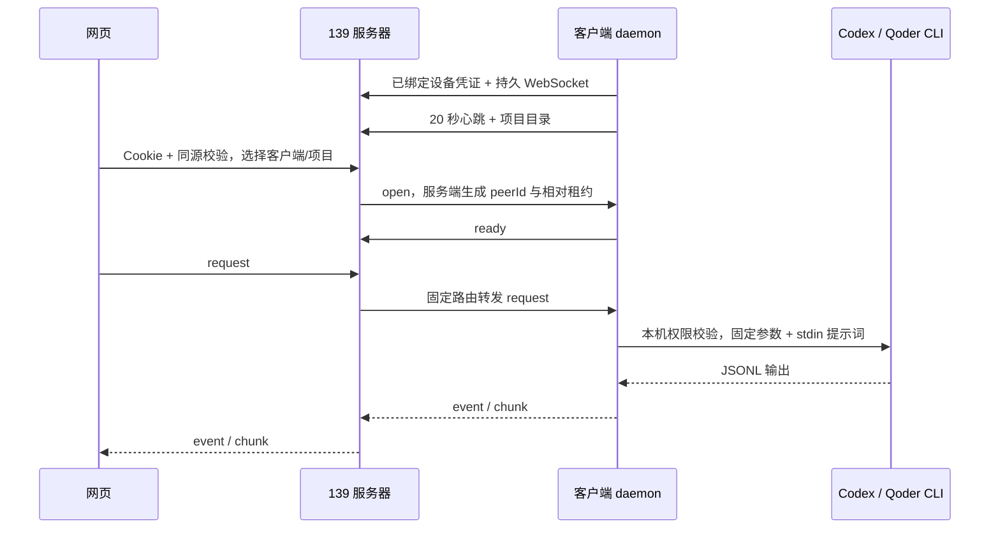

# 架构与协议

当前协议基线：2026-10-25。目标见 [project-goals.md](project-goals.md)，关系和命名见 [session-model.md](session-model.md)，Windows 生命周期见 [windows-service-msi.md](windows-service-msi.md)，139 Codex 多账号见 [codex-account-management.md](codex-account-management.md)。开发直接在 `main`。

## 连接与执行

客户端 `/api/agent/connect?id=…&transport=relay-v1` 使用独立 Bearer 凭证；网页 `/api/agents/{id}/connect` 使用账号登录态和同源检查，支持 `/agents` 子路径。20 秒心跳、65 秒无响应断开，客户端持续退避重连。旧客户端返回 426，服务器/网页/安装包需一起升级。没有 WebRTC、P2P 或 STUN/TURN 回退，不需要客户端开放入站端口。

服务器覆盖所有路由 ID，只转发当前设备的对应连接；单设备最多 8 个网页/工具连接，网页最长相对租约 30 分钟。请求限 64 KiB、中转帧限 256 KiB；每个连接的客户端有界有序队列 16 项，心跳与业务处理分离。网络写超时 10 秒。大结果超过 48 KiB 分成 16 KiB base64 `chunk`，最后 `result:{chunked:true}`；网页合并上限 32 MiB。

注销、账号停用、设备撤销、连接替换和租约过期关闭对应网页连接及交互任务；已经接受的后台 Web 任务由 daemon 生命周期管理。服务器不持久保存任务正文、输出或录音。两段 TLS 在可信服务器终止，服务器会转发并可见内容。Nginx 需保留 Upgrade 头、关闭缓冲、允许长读超时。

## 共享协议

`internal/protocol` 定义 `Signal`、`Request`、`Event`。网页使用的主要请求：

| 请求 | 行为 |
| --- | --- |
| `services.list/add/remove` | 本机项目、执行器、允许根目录和完整授权；add 额外返回首个 Web session，重试幂等复用；移除有渠道的项目被拒绝 |
| `directories.list/search` | 仅白名单内真实目录，规范化并检查符号链接 |
| `sessions.list/create/get` | 本机历史分页、搜索和原生上下文恢复 |
| `run/cancel` | 当前 Web 会话的 CLI 交互，固定进程参数、20 分钟超时 |
| `tasks.start/cancel` | 派生独立 Web 会话及 daemon 后台任务 |
| `channels.get/configure/notify` | 脱敏配置读取、验证/绑定/解绑、持久通知 |
| `sayso.open/call` | 项目固定 SaySo 讨论及受限讨论/Action/录音 API |

设备凭证可访问 `/api/agent/catalog` 和 `/api/agent/tools`；后者只允许 `tasks.start` 与 `channels.notify`，源/目标/通知设备必须属于同一有效账号。服务端通过现有目标 WebSocket 建立短暂工具连接，等待 ready 后发送请求，最多 25 秒。设备离线明确失败，不向任意 URL/命令代理。详见 [会话模型](session-model.md)。

## 本地数据与权限

客户端配置保存设备身份、服务器、项目、允许目录、写入策略及渠道 Secret。`history.db` 保存 Web/IM 会话、原生 ID、聊天记录、任务来源和通知队列。SaySo `sayso/state.json` 原子保存讨论/Action，录音在 `sayso/recordings/`。升级保留全部目录；旧空 Kind 视作 Web，旧 SaySo 按相同工作目录绑定到原项目并保留原讨论/录音 ID，其他执行器项目独立创建绑定。

所有模型调用共享设备级单任务互斥。按当前产品要求，Web、IM、SaySo 均完整授权：Codex `danger-full-access` / `approval_policy=never`，Qoder `bypass_permissions`。旧 allowWrite=false 配置读取时内存迁移为 full，项目注册仍检查允许目录；旧 Windows 文件系统 RX 授权须通过 connect 的管理员服务配置更新。MCP 注入仅当前进程生效，Windows npm `.cmd` 路径使用经过原生 PowerShell/shim 验证的参数编码。

SaySo 仅接受预定义的 state/settings/projects/sessions/actions/runs/audio 路径，禁止任意 URL/文件路径。录音仅用户主动在网页开始；按 16 KB 分片，经 139 转发至客户端，每段限 64 MiB。未完成上传在断连/重启后清理，页面提供备份；浏览器崩溃前尚未停止的录音不能保证恢复。Action 派发创建新 Web 会话，保留动作/讨论关联及取消入口。

## 身份、模型代理与部署

仅管理员创建平台账号，bcrypt 密码，30 天 HttpOnly 登录 Cookie，同源写请求。用户名 Unicode 归一比较并保持稳定账号 ID；改名/改密码撤销已有会话。账号停用阻止设备、绑定、模型与工具访问，不能移除最后一名有效管理员。

个人模型 Token 使用 SHA-256 验证；新 Token 另以 AES-GCM 加密保存，只有所属账号可通过同源 POST 再次读取/复制。普通及管理员列表仅返回元数据，管理员不能读取他人的 Token。旧哈希记录继续有效但无法复制，不提供补存入口。绑定时凭设备认证幂等申请设备关联 Token，默认 codex setup 使用该绑定并显示账号名/ID；手动粘贴的 Token 经 `/api/token/account` 验证账号。数据库旁的 `<数据库路径>.token-key` 必须与数据库成套备份恢复；密钥丢失且已有密文时拒绝生成替代密钥。

设备修复复用本地绑定；owner-only `/api/agents/{id}/rebind` 另外生成 15 分钟恢复凭证，生成时不影响旧设备。兑换核对 expectedId 后事务替换同设备 credential，保留项目和 Token；客户端在兑换前私有保存候选凭证与原配置备份，HTTP 响应丢失或写配置失败可用 `.rebind-pending.json` 继续。设备凭证成功更新才关闭旧连接。原配置和全部备份均丢失时，服务端无法恢复只存本机的 IM Secret。

`/codex/v1` 适配固定 loopback 网关，使用服务器私有服务凭证，允许 Responses/Compact/模型目录及 SSE，替换授权并剥离路由覆盖。全实例最多 20 个活动模型请求，与 loopback 连接池及 139 后端容量一致；32 MiB 请求体、30 分钟期限，等待上游响应头最多 3 分钟，以容纳后端凭证刷新及首次响应，SSE 及时 flush。账号停用取消活动请求；不存储模型正文。

139 网关账号管理使用独立控制 Token，与模型服务 Token 分开。管理员通过白名单 API 获得账号状态、重新授权 URL/设备码、取消和切换活跃账号；各账号独立 CODEX_HOME，旧 OAuth 原地保留。添加账号不自动切换当前代理账号。

网关 URL 仅允许字面 loopback IP 的 HTTP 根地址，关闭重定向和环境代理。私有凭证源文件为 0600；systemd `LoadCredential` 下发到规范的 `/run/credentials/<unit>`。只有受保护 credential 命名空间内允许 0440，普通组可读文件仍拒绝。

生产升级停止服务后备份 bbolt 数据库、二进制/dist、env、Nginx 和 systemd unit，成套回滚，不用旧进程打开已经迁移的新数据库。保留 `/openai/` 旧入口、旧模型 Token、注册设备和原 OAuth。服务器、六平台客户端及 x64/ARM64 MSI 必须使用同一提交构建；发布前运行 Go tests/vet、Linux race、JS 检查、SaySo 可复现构建及隔离 Windows MSI/SCM 验收。

## 代码目录

| 目录 | 职责 |
| --- | --- |
| `cmd/server`、`internal/server`、`internal/store` | 账号/设备、139 中转、项目目录与机器人唯一绑定、模型入口 |
| `cmd/agent`、`internal/agent` | daemon、服务/MSI 环境、CLI/MCP、项目/历史、后台任务、IM 与 SaySo |
| `cmd/personal-gateway`、`internal/personalgateway` | 139 原生 Codex 网关与多账号设备授权 |
| `internal/codexsetup` | 官方 Codex 安装校验与配置备份/合并 |
| `web`、`sayso-ui` | 内嵌工作台与 SaySo React 源码/产物 |
| `tools`、`packaging`、`deploy`、`.github/workflows` | 六平台构建、MSI、系统服务、部署与验证 |
