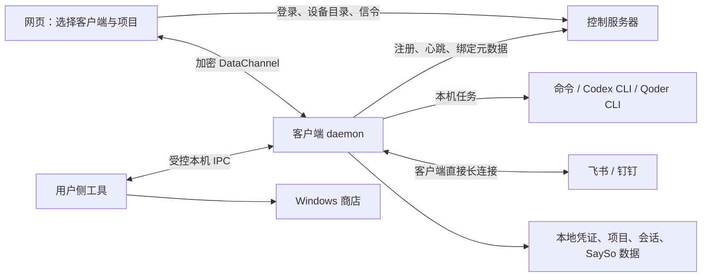
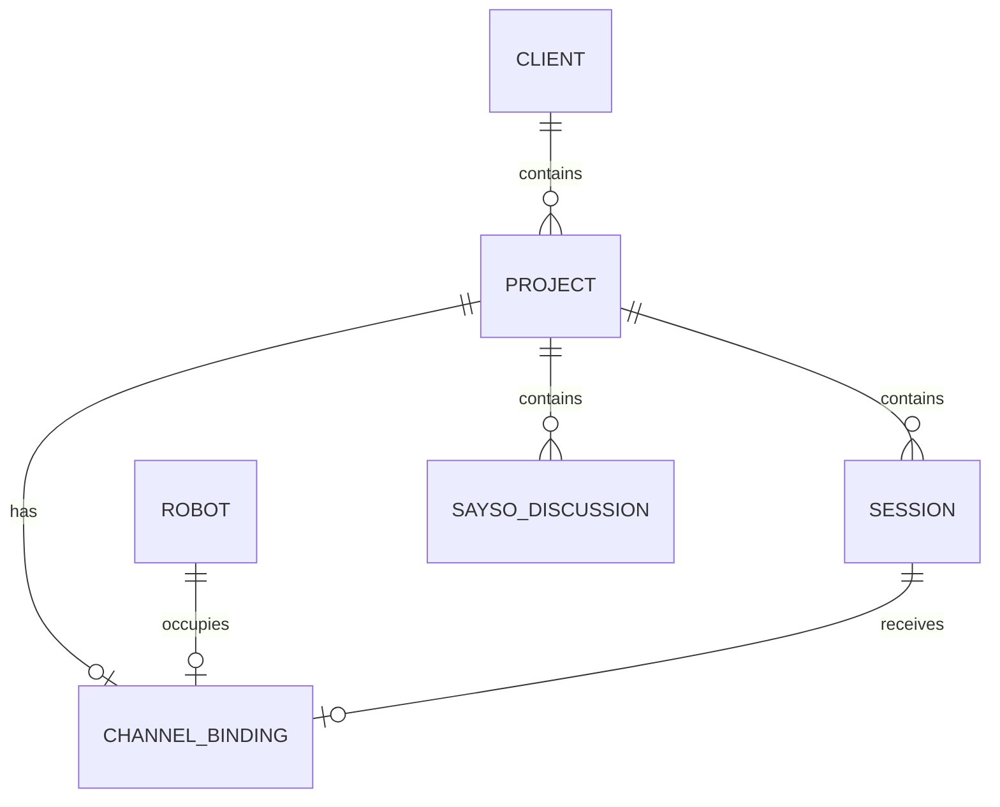

> 最新连接要求：所有网页与客户端业务流量经 139 站点中转；客户端使用持久 WebSocket，取消 WebRTC 直连。IM 机器人仍由客户端直接连接飞书/钉钉，密钥仅存本机。

# 项目目标、现状与验收

基线日期：2026-10-23。依据本次项目核对及用户补充：`code` 指 **Qoder**；Windows 客户端需要开机运行，用户退出登录后仍保持在线。本文定义目标，现有行为和接口以 [architecture.md](architecture.md) 为准。

2026-10-24 更新：已加入 Windows Service、x64/ARM64 MSI、原目录数据保留、旧任务迁移及隔离的 MSI/SCM 验收套件，详见 [Windows 安装与服务](windows-service-msi.md)。真实冷启动/桌面退出和原生 ARM64 仍需目标环境验收。

## 目标

搭建一个由服务器管理设备和网页入口、由客户端执行本机任务的工作平台。用户从网页选择某台客户端上的项目，执行命令、使用 Codex/Qoder 会话或进入 SaySo；也可把飞书/钉钉机器人接入该项目的固定会话。

Windows 是本轮客户端交付重点，正式安装形式为 MSI，后台由 Windows Service 维持。现有 macOS/Linux 能力继续保留。开发直接提交并推送到 `main`。

## 职责和数据流

| 组件 | 目标职责 | 主要持久数据 |
| --- | --- | --- |
| 服务端 | 账号与授权、各系统的设备注册、设备状态和保活协调、项目目录、机器人绑定唯一性、WebSocket 中转与保活、网页和安装包分发 | 账号、设备凭证验证值、设备/项目元数据、机器人身份指纹及绑定归属 |
| 客户端 daemon | 开机常驻、重连、项目管理、命令和 CLI 进程管理、工具检测、Codex 配置和安装更新、消息渠道长连接 | 本机设备凭证、项目、任务和会话、Codex 配置、机器人 AK/SK、SaySo 数据 |
| 客户端用户侧工具 | 本机初始配置、诊断、需要桌面的商店入口；通过受控本机 IPC 与服务协作 | 用户界面设置；凭证交给本机受保护存储 |
| 网页 | 账号/设备/项目管理、查看工具状态、发起任务、查看与继续会话、配置渠道、按项目进入 SaySo | 登录 Cookie 和界面偏好；业务数据从客户端读取 |

服务器与客户端各自通过所在操作系统的服务管理器维持进程，服务器通过心跳观察设备状态。网络恢复后客户端自行重连；关机或睡眠期间显示离线。

现有模型代理是可选的独立数据流：Codex → HTTPS 模型入口 → 既有模型网关。使用该代理时，模型请求内容会经过模型入口；“任务和输出保存在客户端”描述的是远程任务通道。机器人消息也会经过相应消息平台。

## Windows 安装与 daemon

- MSI 负责正式安装、升级、修复和卸载，安装并管理 Windows Service。首次绑定和后续升级分开处理，升级保留设备身份、项目、配置、会话和录音。
- Service 自动随系统启动，崩溃恢复，网络恢复后重新连接；首次用户登录前以及用户退出登录后均能保持设备在线，已配置的非交互任务和消息渠道仍能工作。
- 服务宿主和任务执行身份需要显式设计：记录所操作用户的 SID、配置目录、项目权限、工具路径和 `CODEX_HOME`，验收冷启动后的实际访问权限。不能直接沿用登录终端的 PATH、默认 home 或临时环境变量。
- 任务按配置的本机身份及授权执行；服务宿主的权限不能隐式成为所有远程任务的权限。已有用户安装迁移至服务模式时，保留原身份和数据，避免两个 daemon 重复连接。
- 商店页面、App 登录等桌面操作通过已登录用户侧工具进行。无人登录时明确显示待用户操作，并提供本机操作入口；不能把成功启动后台进程当作商店已显示或 App 已更新。
- MSI 卸载停止服务和渠道连接，明确区分移除程序与清除本地业务数据。升级失败可恢复旧程序和数据；凭证不放入 MSI 包、命令行属性或安装日志。

此处的 MSI 是 **Remote Agent 客户端的安装包**。Codex App 的安装/更新入口使用 Windows 商店。Windows Service 与桌面交互分离的依据见 [Microsoft 服务交互说明](https://learn.microsoft.com/en-us/windows/win32/services/interactive-services)。

## 客户端服务

| 能力 | 目标行为 |
| --- | --- |
| 本机命令执行 | 在选定项目目录执行命令，返回 stdout/stderr、退出码和任务状态，支持超时与取消；本机授权决定可执行范围 |
| 工具检测 | 分别返回 Codex CLI、Codex App、Qoder CLI/编辑器的安装、版本、路径和可用状态；安装/更新后可刷新检测 |
| Codex 配置 | 可配置模型代理地址和 Token，备份并保留其他 Codex 配置；尊重目标用户的 `CODEX_HOME`，凭证不回显、不写运行日志 |
| Codex CLI | 安装和更新，验证来源与校验值，失败保留可用版本，完成后重新检测 |
| Codex App | Windows 上打开对应商店页面，让用户完成安装或更新，再刷新状态 |
| 项目和会话 | 统一项目身份，复用 Codex/Qoder 原生会话上下文，网页与消息渠道可查看同一固定会话 |
| 消息渠道 | 创建、测试、绑定、启停、解绑，客户端直接连飞书/钉钉的长连接服务 |

“执行命令”包含独立的本机命令能力；当前仅启动 Codex/Qoder 的 `run` 不能视为已经实现通用命令执行。Qoder CLI 安装/更新不在本次明确要求内，先满足检测与任务调用。

Codex 配置的目标包含用户指定的代理地址和 Token。现有 `codex setup` 面向本平台 `/codex/v1` 及 `ra_codex_` Token，还需补充通用代理配置入口和网页端的管理操作。

商店产品入口参考 [OpenAI Windows 安装说明](https://learn.chatgpt.com/docs/app/windows)，URI 形式参考 [Microsoft 商店 URI 文档](https://learn.microsoft.com/en-us/windows/apps/develop/launch/launch-store-app)。

## 项目、session 与消息渠道

目标关系如下；其中统一项目和渠道绑定模型尚待实现：

- 客户端拥有多个项目。项目由客户端 ID 与稳定项目 ID 定位，指向规范化的本机目录；同一目录使用 Codex 或 Qoder 时复用同一个项目身份。
- 项目可以有多个普通 session。一个渠道绑定必须指定该项目下的一个固定 session，持久保存其提供方和原生会话恢复信息；收到下一条消息时继续这个 session。
- 一个客户端项目最多绑定一个渠道。飞书和钉钉合计受此约束，不能各占一个。
- 一个平台内，一个机器人最多绑定一个客户端项目，跨客户端也需检查。客户端基于消息平台、租户及经验证的稳定机器人标识生成身份指纹；服务端登记此指纹，AK/SK 轮换不能绕过唯一约束。
- 服务端原子登记机器人与项目的绑定归属，客户端保存绑定 ID、固定 session 与凭证。服务端只收最小元数据，不接收原始 AK/SK；新绑定成功后客户端才启用长连接。
- 换绑需先停止旧渠道并释放登记；旧客户端离线、无法确认释放时拒绝抢占，明确提示原绑定归属。服务端与客户端配置部分失败时回滚或标记待恢复，不能悄悄形成双绑定。
- 网页切换项目或会话不改变渠道映射。解绑只停止渠道并释放占用，保留原 session 历史；删除被绑定的项目/session 需先处理绑定。

这里的 `session` 是普通 Codex/Qoder 工作会话。SaySo 讨论会话单独管理，和工作会话通过同一个项目关联。

### 消息通道生命周期

1. 用户选择客户端和项目，填写渠道类型及 AK/SK，选择或创建固定 session。凭证经已认证的直连通道交给客户端。
2. 客户端校验机器人身份；服务端检查设备归属及项目/机器人唯一性，登记绑定。
3. daemon 直接连接平台长连接服务，接收消息、按消息 ID 去重、按固定 session 顺序处理任务，并回复对应渠道。
4. 浏览器关闭不影响渠道；网络中断后重连。进程重启恢复绑定、会话和处理进度，避免重连或平台重投导致重复执行。
5. Web 与机器人任务复用客户端任务调度和本机权限；忙碌、排队、超时和取消都需有明确反馈。渠道任务的生命周期由 daemon 管理，不依赖浏览器 Peer。

AK/SK（如平台的 App ID/App Secret、Client ID/Client Secret）只落客户端受保护存储。服务端心跳、数据库、错误、日志与浏览器持久存储不包含 Secret；平台消息临时回复凭证也不得泄露。凭证存储和加密需与服务执行身份匹配。

## 网页中的 SaySo

- 入口固定为“客户端 → 项目 → SaySo”。进入后选中该项目，并显示客户端名称和项目目录。
- 普通工作台、机器人与 SaySo 使用同一项目身份；讨论会话、录音、Action 和执行记录仍保存在该客户端。
- 添加项目后可直接进入该项目的 SaySo；不依赖 SaySo 第一次初始化时的目录复制。切换项目后正确切换讨论与 Action，旧数据继续可用。
- 保留现有录音、文字补充、分析、Action 确认与执行能力。录音发生在用户浏览器，daemon 在线本身不会自动开始录音。

## 现状盘点

已将旧 `codex/unified-codex-platform` 分支的两笔提交汇入 `main`。以下按本次整理后的代码盘点，历史部署证据单独保留在原设计/计划中。

| 目标 | 当前实现 | 差距 |
| --- | --- | --- |
| 服务端账号、设备注册、保活、网页 | 已实现；管理员创建账号，设备一次性绑定，心跳、撤销、信令与内嵌网页 | 补充统一项目及机器人绑定目录 |
| Windows MSI | WiX 构建 x64/ARM64 MSI；Windows 正式脚本校验安装包后安装；升级/修复/卸载保留业务数据 | 发布者签名及原生 ARM64 安装待验收 |
| 退出登录仍在线 | SCM 自动 Windows Service，LocalService + 服务 SID，原工具环境与数据目录，失败恢复和旧任务迁移 | 真实整机冷启动/退出桌面人工验收 |
| 本机命令执行 | 仅执行固定参数的 Codex/Qoder CLI | 独立命令请求、权限、任务记录与控制待实现 |
| 工具检测 | 检测 Codex/Qoder CLI，区分 Qoder 编辑器启动器 | App/编辑器安装和版本检测、动态刷新待补齐 |
| Codex 配置 | `codex setup` 支持平台代理与 Token、TOML 备份与合并 | 通用代理配置、网页直连操作和服务用户环境待补齐 |
| Codex CLI 安装/更新 | 本机 `codex install/update`，官方完整包及 SHA-256 校验 | 网页触发和服务模式下安装更新待补齐 |
| Codex App | Windows `app install/upgrade` 已改为打开商店页面；macOS 保留 brew | 实际商店 UI/完成状态、服务到用户侧协作待验收或实现 |
| 项目/普通 session | `Service` 含提供方与目录；本机会话支持恢复 | 独立项目模型、跨提供方项目身份和渠道固定会话待实现 |
| 飞书/钉钉 | 无渠道实现 | 两个平台适配器、AK/SK 存储、绑定唯一性、后台调度与恢复待实现 |
| SaySo | 已集成讨论、录音、分析、Action；设备入口，首次复制已注册目录 | 按工作台项目进入、统一项目映射和存量迁移待实现 |

### 代码目录

| 目录 | 当前职责 |
| --- | --- |
| `cmd/server`、`internal/server`、`internal/store` | 服务启动、账号与设备接口、信令、可选模型代理、控制面数据 |
| `cmd/agent`、`internal/agent` | 客户端命令、daemon、工具调用、服务配置、历史、自启动与更新、SaySo 本地后端 |
| `internal/codexsetup` | Codex 下载、校验、安装和配置 |
| `internal/protocol` | 服务器/客户端/网页共享的数据协议 |
| `web`、`sayso-ui` | 内嵌工作台、SaySo 源界面与产物 |
| `tools/build`、`tools/msi`、`packaging/windows`、`deploy`、`.github/workflows` | 多平台构建、Windows MSI/服务验收、服务端部署与 CI |

## 实施顺序与验收

1. **Windows 基础交付。** 实现 Service 与任务身份、MSI、旧用户安装迁移；用冷启动未登录、退出登录、网络重连、进程崩溃、升级失败回滚、卸载验收。必须验证此时真实项目访问与 CLI 任务仍正常，避免只验心跳。
2. **本机管理能力。** 补齐工具检测、通用命令执行、通用代理配置、网页操作和用户侧商店入口。用模拟程序验证输出/退出码/取消；在隔离配置目录验证 Token 不回显、原 TOML 和登录态保留；在真实 Windows 用户会话验收商店显示及安装后状态。
3. **统一项目与消息渠道。** 迁移现有 Service/会话/SaySo 的项目关联，再接入飞书、钉钉。验收同项目第二渠道、同机器人跨项目/跨客户端并发绑定均被拒绝；轮换凭证不改归属，解绑可重绑。用平台测试机器人验证流式接收、固定 session、去重、回复、重启恢复和关闭网页后继续工作。
4. **项目 SaySo 与整体贯通。** 选择客户端 A 的项目 X 后进入 SaySo，新增与已有讨论均归 X；切换项目无串数据。回到工作台可继续相同项目任务，历史会话和录音可恢复。

以上是下一阶段交付清单。当前本地 Go 测试、JS 检查及交叉编译不能代替 MSI、退出登录后的 Service、真实机器人和商店 UI 的验收。生产部署记录也不能视作这些新目标已完成。
