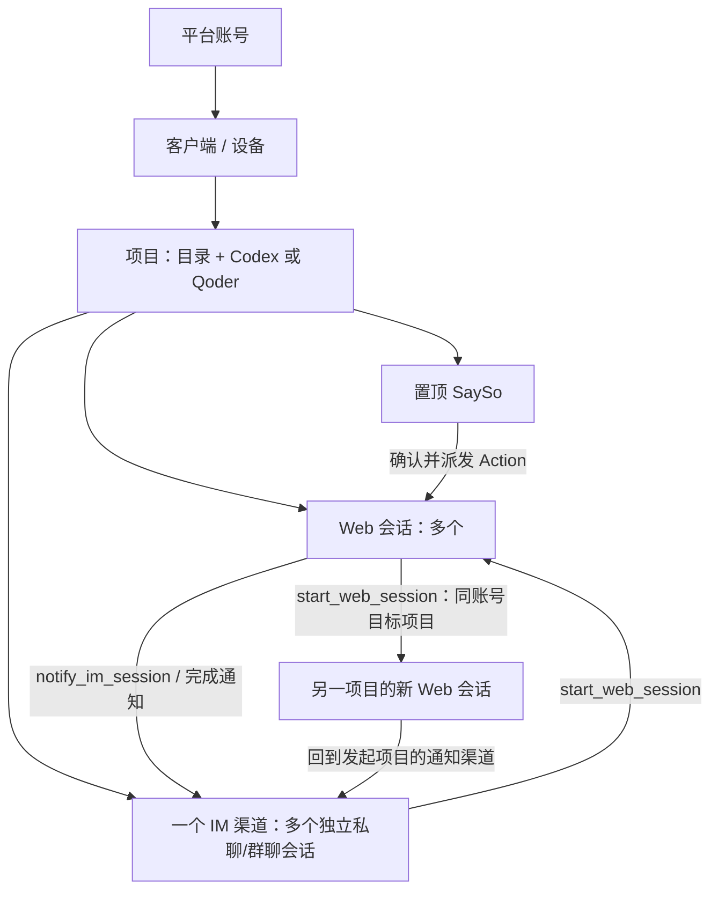

# 客户端、项目与会话

2026-10-25。网页统一使用以下名称；Go 中现有 `Agent` 对应客户端、`Service` 对应项目，保留原 ID 和存储格式。

| 名称 | 定义 | 数量与归属 |
| --- | --- | --- |
| 客户端 Client | 一台设备上常驻的 Remote Agent daemon | 属于一个平台账号，可有多个项目 |
| 项目 Project | 本机工作目录 + 执行器 Codex/Qoder + 稳定项目 ID | 属于一个客户端；同目录不同执行器可分别注册，图标区分 |
| Web 会话 | 实际执行工作的 Codex/Qoder 原生上下文 | 每项目多个；可手工创建，也可由其他会话或 SaySo Action 创建 |
| IM 渠道会话 | 飞书/钉钉中的独立私聊或群聊上下文 | 每项目最多一个渠道；机器人全平台只绑定一个项目；每个来信会话映射持久独立 session，显示渠道和对方名称 |
| SaySo 讨论 | 讨论、录音、转写、分析和 Action 的工作区 | 每项目固定置顶一个入口；旧讨论和录音继续保留，可在内部选择历史讨论 |
| Action | 经确认后可执行的 SaySo 工作项 | 每次派发创建一个新的 Web 会话，保存 Action、讨论、任务与 Web 会话的关联 |

## 会话可用的客户端工具

daemon 每次启动 Codex/Qoder 工作进程时注入 `remote_agent` MCP；不修改用户长期 MCP 配置。Codex 使用本次进程的 TOML 覆盖参数，Qoder 使用临时私有 MCP 配置，结束后删除。设备凭证从本机私有配置读取，不出现在工具参数、模型返回或命令行。

| MCP 工具 | 行为 |
| --- | --- |
| `list_clients_projects` | 列出当前账号所有未撤销客户端、在线状态、项目 ID/名称/执行器；不返回设备凭证、机器人 Secret 或目录路径 |
| `start_web_session` | 在同账号指定客户端和项目新建 Web 会话，保存提示词、来源和父会话，排队执行；立即返回会话 ID、任务 ID |
| `notify_im_session` | 将进度或完成消息放入目标项目渠道会话及通知队列；要求已绑定渠道，默认返回任务来源项目；可显式选择同账号其他项目 |

IM 会话用于接收需求和回复用户；执行工作时调用 `start_web_session`。IM 派生任务在 MCP 和客户端接收层默认通知完成；其他调用可指定 `notify:true`。跨设备及嵌套派生任务继承原始通知客户端、项目和 `notifySessionId`，回到原私聊/群聊。普通 Web 会话也可主动发送阶段通知、创建其他 Web 工作会话；有多个 IM 目标时必须指定 sessionId，不能猜测最近收件人。

创建任务后，IM 助手立即简短回复已排队，不等待执行完成，不附网页会话地址。固定 IM 提示、派生任务提示和 MCP 初始化说明共用结果交付约束：最终回答用中文给出实质结论、关键结果、验证/提交情况及待处理事项，自动通知直接回传这些内容。客户端提取当前任务的最后一个已完成 Codex `agent_message`（排除明确的 commentary）或 Qoder assistant/result，单独保存在 `history.db`，不混入工具日志；无结构化输出的旧执行器回退当前轮 assistant 文本。未获得最终文本时明确提示，失败/取消/重启中断时报告原因及已有的部分结果，不能仅报成功。长结果按 UTF-8 字节边界分段，自动完成通知不再生成网页链接；IM 出站仅过滤本站工作台会话地址，网页历史和其他正常链接保留。

`notify_im_session` 默认发送进度，不抑制自动完成回传；如主动发送最终实质结果，应传 `final:true`。仅成功入队到任务继承的原始客户端/项目/会话后，工作客户端才持久标记该任务已发送最终通知，避免随后重复自动结果；失败或发给其他会话不抑制来源通知。此标记不影响后续失败回报。旧调用未标记 final 时仍按进度处理，调用方应遵循固定提示，避免自行重复最终结果。

所有目录查询、创建会话和跨设备通知均通过 139 站点。服务端根据源设备凭证确认账号、目标设备归属及撤销状态，覆盖父客户端路由；不支持跨账号操作。目标客户端再次检查项目、允许目录、执行器可用性和本机写入策略。MCP 工具不会授予额外文件权限。

## 后台任务与恢复

每台客户端支持多个 CLI 任务并发执行，包括同一项目的不同会话、交互式 Web 和 SaySo 分析。后台最多接受 32 个未完成任务（包含运行中和排队中的任务），不同会话立即并发，同一会话按接收顺序执行并在启动时恢复最新原生上下文；交互式 `run` 对正在运行的同一会话返回忙碌提示。普通网页交互 `run` 随该网页连接取消；`start_web_session`、IM 和已派发 Action 由 daemon 管理，关闭网页或 139 短暂断线不会取消已接受任务。取消只停止指定任务；服务停止或强制升级会取消全部任务，普通升级须等待全部任务结束。单任务上限为 20 分钟。

会话记录包含 `kind:web/im`、`source:web/im/sayso`、父客户端/会话、Action、任务 ID/状态和通知目标；旧 `kind` 为空按 Web 兼容。CLI 原生会话 ID 持续保存，任务完成后可以从网页继续。状态为 queued/running/done/failed/cancelled。重启将未结束任务标记为中断，保留原提示词、输出和原生 ID，交由用户检查后继续，不自动重放可能已产生副作用的指令。

自动通知（包括同客户端）先写工作客户端持久队列，再进入源客户端的 IM 队列；跨设备经 139，失败 30 秒重试。队列保存精确来源会话，重启后仍按保存目标投递，不使用项目当前默认会话。完成通知每段携带稳定 notificationId，源客户端持久记录已接收 ID，避免中转响应丢失/重启造成重复入队和重复历史。`queued:true` 表示已入队，不代表平台已送达；平台响应丢失可能重复通知。更换机器人/收件目标后，旧队列不会发给新收件人。永久失败需检查绑定/权限后重试，队列上限 1000；不承诺恰好一次。

## IM 配置

项目齿轮配置飞书或钉钉应用机器人，填写渠道名称、应用 ID、Secret，钉钉可填写 RobotCode。默认所有人可聊，无需选择私聊/群聊或填写目标 ID。Secret 再次打开时不返回，留空保留原值。保存后显示配置、连接和成功进度，成功窗口由用户关闭。

- 飞书：发布机器人，订阅 `im.message.receive_v1` 并授予收发权限。启动时通过官方 `/bot/v3/info` 确认机器人 open_id；私聊直接接收，群聊仅接收明确 @ 本机器人的文本。来信 chat_id 自动决定回复目标；查询对方名称的权限缺失不阻断消息处理。参考[获取机器人信息](https://open.feishu.cn/document/client-docs/bot-v3/obtain-bot-info)。
- 钉钉：启用 Stream 回调与消息发送权限；从来信自动获取私聊 staffId 或群聊 openConversationId，群聊需 @ 机器人。消息中的 senderNick/conversationTitle 用于显示名称。
- 每项目仅一个绑定，平台+应用 ID 的 SHA-256 指纹保证机器人全局唯一。配置先验证凭证、预占新指纹，再停止旧连接并原子保存，成功后释放旧占用；保存失败回滚，重连同步可清理中断预占。解绑保留固定会话历史，删除项目前需解绑。
- 入站消息按消息 ID 去重，按机器人身份和 chat_id 持久映射独立 native session，再排队处理；忽略非文本和机器人消息。旧合法目标和历史兼容迁移，非法旧目标不再过滤来信。满队列提示重试；中断的指令不自动重放。
- 飞书使用 Markdown 卡片，钉钉使用 sampleMarkdown。飞书收到消息后添加 THINKING，整段回复投递完成后撤下；错误、取消、发送失败和重启均清理，清理失败持久重试，不重复已发回复。需要机器人消息表情权限。钉钉机器人暂无对应 API，本版本返回 thinkingReactionSupported=false，界面明确说明。

AK/SK 只持久存客户端受保护配置。网页配置请求经两段 TLS 的 139 中转，服务端是可信中转点，瞬时可见请求但不写 Secret 到库或日志；这不是端到端加密。平台消息与通知也会经过飞书/钉钉。真实机器人权限、发布状态、消息接收/发送需用用户自己的测试应用验收。
