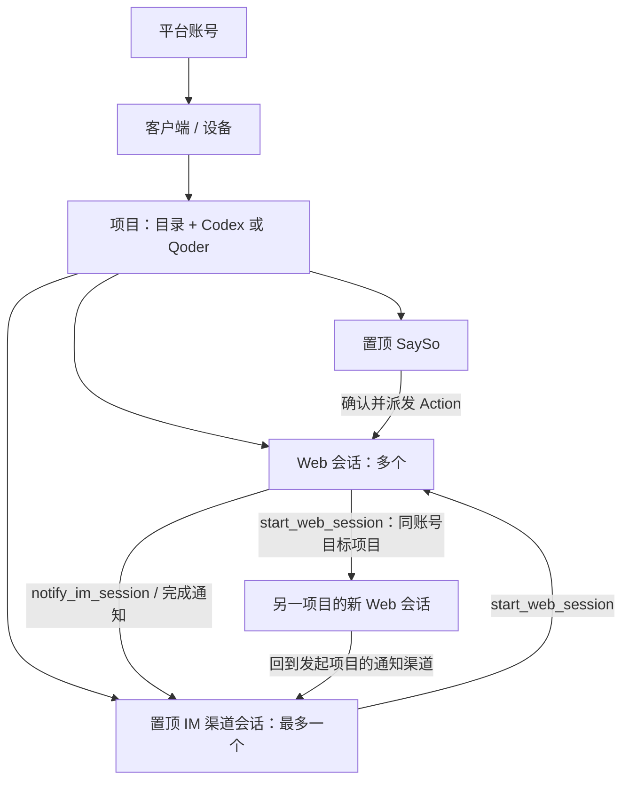

# 客户端、项目与会话

2026-10-24。网页统一使用以下名称；Go 中现有 `Agent` 对应客户端、`Service` 对应项目，保留原 ID 和存储格式。

| 名称 | 定义 | 数量与归属 |
| --- | --- | --- |
| 客户端 Client | 一台设备上常驻的 Remote Agent daemon | 属于一个平台账号，可有多个项目 |
| 项目 Project | 本机工作目录 + 执行器 Codex/Qoder + 稳定项目 ID | 属于一个客户端；同目录不同执行器可分别注册，图标区分 |
| Web 会话 | 实际执行工作的 Codex/Qoder 原生上下文 | 每项目多个；可手工创建，也可由其他会话或 SaySo Action 创建 |
| IM 渠道会话 | 飞书/钉钉消息与回复的固定入口 | 每项目最多一个渠道及固定会话，绑定后置顶；机器人全平台只绑定一个项目 |
| SaySo 讨论 | 讨论、录音、转写、分析和 Action 的工作区 | 每项目固定置顶一个入口；旧讨论和录音继续保留，可在内部选择历史讨论 |
| Action | 经确认后可执行的 SaySo 工作项 | 每次派发创建一个新的 Web 会话，保存 Action、讨论、任务与 Web 会话的关联 |

## 会话可用的客户端工具

daemon 每次启动 Codex/Qoder 工作进程时注入 `remote_agent` MCP；不修改用户长期 MCP 配置。Codex 使用本次进程的 TOML 覆盖参数，Qoder 使用临时私有 MCP 配置，结束后删除。设备凭证从本机私有配置读取，不出现在工具参数、模型返回或命令行。

| MCP 工具 | 行为 |
| --- | --- |
| `list_clients_projects` | 列出当前账号所有未撤销客户端、在线状态、项目 ID/名称/执行器；不返回设备凭证、机器人 Secret 或目录路径 |
| `start_web_session` | 在同账号指定客户端和项目新建 Web 会话，保存提示词、来源和父会话，排队执行；立即返回会话 ID、任务 ID |
| `notify_im_session` | 将进度或完成消息放入目标项目渠道会话及通知队列；要求已绑定渠道，默认返回任务来源项目；可显式选择同账号其他项目 |

IM 会话用于接收需求和回复用户；执行工作时调用 `start_web_session`。IM 派生任务默认通知完成；其他调用可指定 `notify:true`。跨设备派生任务继承原始通知客户端和项目，因此无需给工作设备另配机器人。普通 Web 会话也可主动发送阶段通知、创建其他 Web 工作会话。

所有目录查询、创建会话和跨设备通知均通过 139 站点。服务端根据源设备凭证确认账号、目标设备归属及撤销状态，覆盖父客户端路由；不支持跨账号操作。目标客户端再次检查项目、允许目录、执行器可用性和本机写入策略。MCP 工具不会授予额外文件权限。

## 后台任务与恢复

每台客户端同时执行一个 CLI 任务，后台队列最多 32 项，与交互式 Web 和 SaySo 分析共享互斥。普通网页交互 `run` 随该网页连接取消；`start_web_session`、IM 和已派发 Action 由 daemon 管理，关闭网页或 139 短暂断线不会取消已接受任务。服务停止/升级会取消实际工作，单任务上限沿用 20 分钟。

会话记录包含 `kind:web/im`、`source:web/im/sayso`、父客户端/会话、Action、任务 ID/状态和通知目标；旧 `kind` 为空按 Web 兼容。CLI 原生会话 ID 持续保存，任务完成后可以从网页继续。状态为 queued/running/done/failed/cancelled。重启将未结束任务标记为中断，保留原提示词、输出和原生 ID，交由用户检查后继续，不自动重放可能已产生副作用的指令。

通知先写客户端本地持久队列，再投递 IM；跨设备先持久写工作客户端，再经 139 进入源客户端的 IM 队列，30 秒重试。`queued:true` 表示已入队，不代表平台已送达；平台响应丢失可能重复通知。更换机器人/收件目标后，旧队列不会发给新收件人。永久失败需检查绑定/权限后重试，队列上限 1000；不承诺恰好一次。

## IM 配置

项目齿轮配置飞书或钉钉应用机器人，使用长连接模式，不是仅能发消息的 webhook 自定义机器人。配置应用 ID、Secret、固定接收目标；钉钉可填写 RobotCode。Secret 在页面重新打开时不返回，留空保留原值。

- 飞书：启用并发布机器人，订阅 `im.message.receive_v1`，启用长连接，授予收消息与发消息权限；目标填写 `chat_id`，单聊/群聊类型需对应。启动时通过官方 `/bot/v3/info` 确认机器人 `open_id`；群聊仅接收明确 @ 本机器人的文本，避免其他机器人或人员的 @ 触发。参考[获取机器人信息](https://open.feishu.cn/document/client-docs/bot-v3/obtain-bot-info)及[机器人概述](https://open.feishu.cn/document/client-docs/bot-v3/bot-overview)。
- 钉钉：应用机器人启用 Stream 回调与消息发送权限；群聊填写 `openConversationId`，单聊填写员工 `staffId`。仅接受指定目标的文本，群聊需 @ 机器人。客户端直接建立钉钉长连接，取消时关闭连接并按 daemon 生命周期重连。
- 每项目仅一个绑定，平台+应用 ID 的 SHA-256 指纹保证机器人全局唯一。配置先验证凭证、预占新指纹，再停止旧连接并原子保存，成功后释放旧占用；保存失败回滚，重连同步可清理中断预占。解绑保留固定会话历史，删除项目前需解绑。
- 入站消息按消息 ID 去重并保存到固定会话，再排队处理；只接收已配置收件目标，忽略非文本与机器人消息。满队列会提示重试；已记录但中断的指令不自动重放。

AK/SK 只持久存客户端受保护配置。网页配置请求经两段 TLS 的 139 中转，服务端是可信中转点，瞬时可见请求但不写 Secret 到库或日志；这不是端到端加密。平台消息与通知也会经过飞书/钉钉。真实机器人权限、发布状态、消息接收/发送需用用户自己的测试应用验收。
