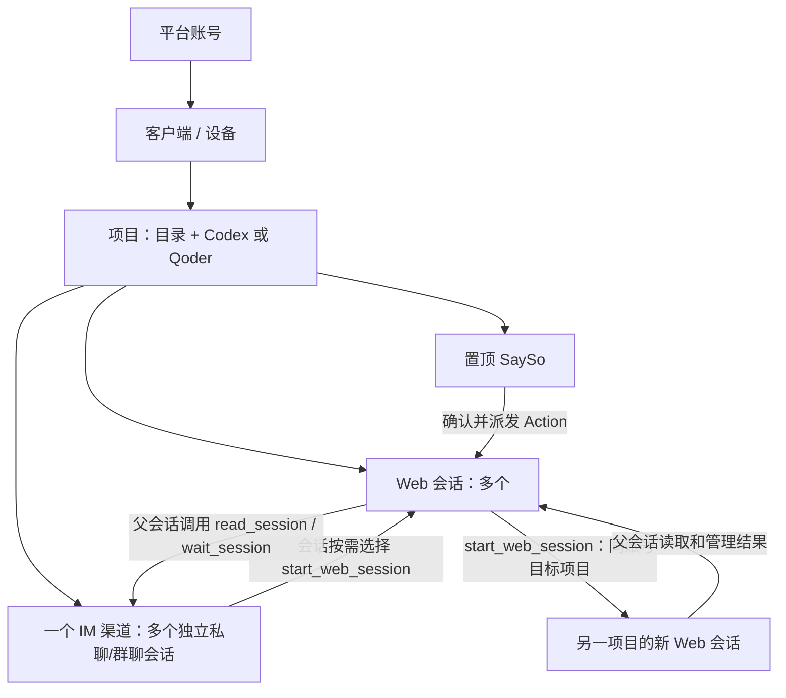

# 客户端、项目与会话

2026-10-31。网页统一使用以下名称；Go 中现有 `Agent` 对应客户端、`Service` 对应项目，保留原 ID 和存储格式。

| 名称 | 定义 | 数量与归属 |
| --- | --- | --- |
| 客户端 Client | 一台设备上常驻的 Remote Agent daemon | 属于一个平台账号，可有多个项目 |
| 项目 Project | 本机工作目录 + 执行器 Codex/Qoder + 稳定项目 ID | 属于一个客户端；同目录不同执行器可分别注册，图标区分 |
| Web 会话 | 实际执行工作的 Codex/Qoder 原生上下文 | 每项目多个；可手工创建，也可由其他会话或 SaySo Action 创建 |
| IM 渠道会话 | 飞书/钉钉中的独立私聊或群聊上下文 | 每项目最多一个渠道；机器人全平台只绑定一个项目；每个来信会话映射持久独立 session，显示渠道和对方名称 |
| SaySo 讨论 | 讨论、录音、转写、分析和 Action 的工作区 | 每项目固定置顶一个入口；旧讨论和录音继续保留，可在内部选择历史讨论 |
| Action | 经确认后可执行的 SaySo 工作项 | 每次派发创建一个新的 Web 会话，保存 Action、讨论、任务与 Web 会话的关联 |

## 会话可用的客户端工具

daemon 每次启动 Codex/Qoder 工作进程时注入 `remote_agent` MCP；不修改用户长期 MCP 配置。Codex 使用本次进程的 TOML 覆盖参数，Qoder 使用临时私有 MCP 配置，结束后删除。设备凭证从本机私有配置读取，不出现在工具参数、模型返回或命令行。

| MCP 工具 | 行为 |
| --- | --- |
| `list_clients_projects` | 按需查询同账号客户端、在线状态和项目，不返回凭据或目录路径 |
| `start_web_session` | 会话自行决定是否在目标项目创建直接子 Web 会话；返回会话/任务 ID，仅代表已接收 |
| `list_child_sessions` | 分页查询当前会话在指定客户端直接创建的子会话，跨客户端分别查询 |
| `read_session` | 读取直接子会话或自身的任务状态、错误及结果；长结果以 nextCursor 分页 |
| `wait_session` | 等待直接子任务完成或至多 20 秒，未完成可继续调用，不触发任何 IM 消息 |
| `send_to_session` | 在已有直接子会话继续任务并复用原生上下文；忙碌时先等待 |
| `cancel_session_task` | 核对直接子会话与当前 taskId 后取消指定任务 |
| `notify_im_session` | 仅在会话决定主动发送额外消息时使用；当前 IM 入口默认投递到自身，Web 必须指定目标 IM sessionId |

用户的每条消息只进入当前选择的 Web 会话或对应私聊/群聊的固定 IM 会话。两类会话都能直接执行工作，自行决定是否拆分、创建和管理子会话。客户端不在用户文本前添加任务拆分、先确认排队或自动完成通知的指令；身份和可用能力只通过本次进程的 MCP 初始化说明提供，CLI 自身和项目的规则仍然适用。

父会话选择派生后，可使用读取/等待工具获得子会话的状态和原始结果，再自行处理并回复用户；不会自动唤醒父会话或开启汇报轮次。任务完成、失败、取消或重启中断都只更新任务状态及历史，不自动向 IM 发送结果，也不再继承原始 IM 通知目标。正常 IM 回复只投递当前 IM session 本轮生成的最终回答，不拼装“任务完成”通知，不替换或过滤会话自行生成的业务链接。未生成最终文本时不伪造成功回复；执行失败仍提供必要的错误提示。长回答按 UTF-8 边界分段投递。

客户端保存最后一个已完成 Codex `agent_message`（排除 commentary）或 Qoder assistant/result 作为结果，工具输出不混入最终文本。read/wait 同时返回 complete、captured、taskError，任务数据与用户指令区分；旧纯文本执行器可回退当前轮 assistant 文本。父会话根据这些状态判断是否完成，不能把排队确认视为结果。

子会话管理只允许认证源客户端的直接父会话操作，read 也可只读自身；不能操作其他私聊、群聊或兄弟会话。会话创建与继续使用当前轮和工具请求生成的稳定请求 ID 去重，重试不重复执行已接受的任务。notify/final 旧参数不再控制自动通知，旧的 notify 元数据保留但停用；主动通知与正常回答没有程序生成的去重或抑制关系，是否主动发送由会话决定。

所有目录查询、创建/管理子会话和主动消息均通过 139 站点。服务端根据源设备凭证确认账号、目标设备归属及撤销状态，覆盖父客户端及管理请求的调用客户端身份；不支持跨账号操作。目标客户端再次检查项目、允许目录、执行器可用性和本机写入策略。MCP 工具不会授予额外文件权限。

## 后台任务与恢复

每台客户端支持多个 CLI 任务并发执行，包括同一项目的不同会话、交互式 Web 和 SaySo 分析。后台最多接受 32 个未完成任务（包含运行中和排队中的任务），不同会话立即并发，同一会话按接收顺序执行并在启动时恢复最新原生上下文；交互式 `run` 对正在运行的同一会话返回忙碌提示。普通网页交互 `run` 随该网页连接取消；`start_web_session`、IM 和已派发 Action 由 daemon 管理，关闭网页或 139 短暂断线不会取消已接受任务。取消只停止指定任务；服务停止或强制升级会取消全部任务，普通升级须等待全部任务结束。单任务上限为 20 分钟。

会话记录包含 `kind:web/im`、`source:web/im/sayso`、父客户端/会话、Action、任务 ID/状态，保留停用的旧通知目标；旧 `kind` 为空按 Web 兼容。CLI 原生会话 ID 持续保存，任务完成后可以从网页继续。状态为 queued/running/done/failed/cancelled。重启将未结束任务标记为中断，保留原提示词、输出和原生 ID，交由用户检查后继续，不自动重放可能已产生副作用的指令。

升级将旧 remote_notifications 及 channel_outbox 中的自动完成消息原样转存到 history.db 的 retired_remote_notifications / retired_channel_outbox 桶，事务失败保留原记录；未转存的自动完成记录也不再投递。旧会话、原生 ID、历史、录音和凭据不迁移或删除。已排队的普通 session 回复及显式通知继续按原始目标投递，更换机器人后不会转给新收件人。queued:true 仅表示入队，不代表平台送达；平台响应丢失仍可能重复发送。

新增 MCP 管理需要服务器和参与客户端一起升级：创建子会话使用 sessions.spawn，管理使用 sessions.control，旧端不认识这些请求时明确失败，不能回退到旧自动通知流程。真实飞书/钉钉收发及跨设备原生 CLI 管理需要目标环境验收，模拟测试不能替代。

## IM 配置

项目齿轮配置飞书或钉钉应用机器人，填写渠道名称、应用 ID、Secret，钉钉可填写 RobotCode。默认所有人可聊，无需选择私聊/群聊或填写目标 ID。Secret 再次打开时不返回，留空保留原值。保存后显示配置、连接和成功进度，成功窗口由用户关闭。

- 飞书：发布机器人，订阅 `im.message.receive_v1` 并授予收发权限。启动时通过官方 `/bot/v3/info` 确认机器人 open_id；私聊直接接收，群聊仅接收明确 @ 本机器人的文本。来信 chat_id 自动决定回复目标；查询对方名称的权限缺失不阻断消息处理。参考[获取机器人信息](https://open.feishu.cn/document/client-docs/bot-v3/obtain-bot-info)。
- 钉钉：启用 Stream 回调与消息发送权限；从来信自动获取私聊 staffId 或群聊 openConversationId，群聊需 @ 机器人。消息中的 senderNick/conversationTitle 用于显示名称。
- 每项目仅一个绑定，平台+应用 ID 的 SHA-256 指纹保证机器人全局唯一。配置先验证凭证、预占新指纹，再停止旧连接并原子保存，成功后释放旧占用；保存失败回滚，重连同步可清理中断预占。解绑保留固定会话历史，删除项目前需解绑。
- 入站消息按消息 ID 去重，按机器人身份和 chat_id 持久映射独立 native session，再排队处理；忽略非文本和机器人消息。旧合法目标和历史兼容迁移，非法旧目标不再过滤来信。满队列提示重试；中断的指令不自动重放。
- 飞书使用 Markdown 卡片，钉钉使用 sampleMarkdown。飞书收到消息后添加 THINKING，整段回复投递完成后撤下；错误、取消、发送失败和重启均清理，清理失败持久重试，不重复已发回复。需要机器人消息表情权限。钉钉机器人暂无对应 API，本版本返回 thinkingReactionSupported=false，界面明确说明。

AK/SK 只持久存客户端受保护配置。网页配置请求经两段 TLS 的 139 中转，服务端是可信中转点，瞬时可见请求但不写 Secret 到库或日志；这不是端到端加密。平台消息与通知也会经过飞书/钉钉。真实机器人权限、发布状态、消息接收/发送需用用户自己的测试应用验收。
