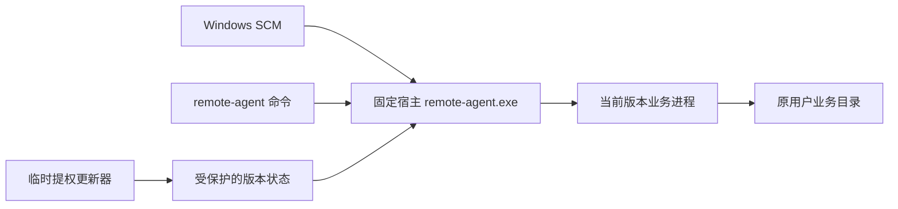

# 客户端更新框架方案

状态：已完成代码调研与方案设计，尚未实现运行时版本切换。当前版本仍由 MSI 安装 Windows 客户端；本次先修复 MSI 安装/升级/修复页面。本文不将设计列为已交付功能。

## 目标与边界

用户执行 `remote-agent update` 即可更新业务逻辑。常规更新保持 MSI 产品、安装目录、`RemoteAgent` 服务名称和 SID、LocalService 身份、SCM 自动启动/恢复设置、系统 PATH 不变；不重新授权全部用户目录，不创建计划任务。账号绑定、配置、项目、会话和录音仍使用原位置。

首次迁移到此框架需要安装一次新版 MSI。后续仅在宿主协议、服务身份、PATH、系统依赖或卸载规则改变时更新 MSI；普通客户端代码变更通过运行时更新完成。Windows 应用列表显示宿主安装版本，`remote-agent version` 同时显示宿主与业务版本，避免把二者混为一谈。

## 方案比较

| 方案 | 优点 | 代价及适用范围 |
| --- | --- | --- |
| 固定宿主 + 独立版本目录（推荐） | 满足固定注册、业务独立更新、保留上一版及失败回退 | 要拆分 SCM 宿主和业务进程，定义兼容协议 |
| 每次由 update 调用新版 MSI | 易复用现有事务、UAC、升级回滚 | 每次仍是 MSI 产品升级，适合框架上线前过渡及宿主升级 |
| 直接覆盖 MSI 拥有的 remote-agent.exe | 改动较少 | MSI 修复可能恢复旧文件、版本信息不同步，运行中文件被锁；不采用 |

## 文件归属

```text
%ProgramFiles%\Remote Agent\
  remote-agent.exe                 固定 CLI 启动器与 Windows SCM 宿主；MSI 拥有
  seed\remote-agent-core.exe       随 MSI 提供的初始业务程序；MSI 拥有

%ProgramData%\RemoteAgent\
  service.json                     沿用现有受保护的用户环境/配置路径
  runtime\state.json               受保护的活动/上一版本与更新事务状态
  runtime\versions\<sha256>\
    remote-agent-core.exe          更新器管理，不覆盖 MSI 文件
    release.json                   签名发布信息
  update-logs\                     更新器日志；不包含 Token 或任务正文
  health\                          服务可写的就绪/失败记录，不能提供可执行路径

原用户目录\.remote-agent\           原配置、history.db、SaySo 讨论与录音
```

运行时代码及 `state.json` 仅管理员和 SYSTEM 可修改，普通用户及 RemoteAgent 服务 SID可读。LocalService 不获得写入运行时代码的权限。`health` 单独授予服务 SID 写权限；宿主绝不把该目录的任意路径当作程序执行。

## 服务与 CLI 进程



SCM 必须由固定宿主连接。不能只启动子进程并让子进程运行现有 `service run`：当前服务注册和 SCM 生命周期属于宿主进程。固定宿主承担 StartPending/Running/Stop/Shutdown、Job Object 子进程清理与就绪超时；业务进程提供内部 worker 入口，沿用 `service.json` 捕获的用户环境和数据路径。

宿主与 worker 使用继承的匿名管道，协议 v1 包含 `prepare/ready/activate/stop`。worker 先打开并验证本地配置与存储，报告本地就绪；收到 activate 后才接收任务。无绑定时进入等待配置状态也算正常启动；139 离线不算版本故障，不触发回滚。普通 CLI 命令转发原参数、输入输出、取消信号和退出码；内部 worker 参数不出现在常用帮助中。

## 更新流程

1. 从原配置服务器（或显式 `--server`）读取平台发布信息，不要求仅使用模型代理的电脑先绑定设备。`--check` 只读取和比较信息，不写状态、不提权。
2. 检查 OS/架构、发布序号、最低宿主版本、worker 协议、下载大小、SHA-256 与 Ed25519 发布签名。公钥内置宿主，私钥仅在发布环境保存，下载不携带设备/模型凭证。最低宿主版本不足时，命令自动转为已校验 MSI 升级并提示原因。
3. 检查是否有正在执行的任务。默认要求任务结束后重试；显式强制更新时按现有取消流程保留提示词、已有输出和恢复 ID，不自动重发任务。
4. 在受保护目录取得单实例更新锁。由临时 UAC 提权的更新器建立待安装版本目录，下载、校验、落盘并原子重命名；普通用户临时目录中的未验证文件不能直接作为管理员程序运行。
5. 记录原运行/停止状态与 `current/previous`，仅停止已有服务。写入 pending 状态后，用固定宿主以 prepare 模式启动候选 worker，检查本地就绪和协议。
6. 候选正常时原子提交 current/previous，再 activate。候选失败时恢复原选择并启动上一版。用户原先停止或禁用的服务不被升级流程擅自启用。
7. 提权更新器退出。保留当前版和上一稳定版，清理其他未使用版本；路径必须属于固定 runtime 根目录且不是重解析点。CLI 输出版本、服务状态和日志位置。

宿主启动候选失败时可在内存中回退到受保护状态已批准的上一版；服务无权更改代码和受保护状态。健康目录仅记录实际运行版本及失败原因，不能指定第三个版本。下一次提权更新操作负责修正持久状态。宿主升级走 MSI，核心升级不改 SCM 注册。

## 发布协议与兼容

新增独立版本化发布入口 `/updates/v1/<os>/<arch>.json`，保留现有 `/downloads` 文件和 SHA-256 接口，避免旧客户端失去更新入口。发布信息包含 `schemaVersion`、单调递增发布序号、业务版本/提交、架构、签名、文件大小/摘要、最低宿主版本、worker 协议版本、最低可回退数据版本，以及宿主 MSI 升级信息。

客户端仅接受已配置站点中固定下载路径，不跟随重定向到任意来源。签名检查必须在运行任何下载代码前完成。显式回滚只允许保留的已验证上一稳定版本，并检查数据版本；普通更新不把过期发布或任意历史版本当作最新版本。

发布签名包含 key ID，宿主只信任内置公钥集合。密钥轮换或吊销通过宿主 MSI 更新信任锚；业务发布清单不能自行提供新公钥或取消签名检查。无法满足新信任链时停止业务更新，明确提示先更新宿主。

跨平台发布信息、校验和事务状态可共用 `internal/clientupdate`。Windows 新增 `cmd/agent-host` / `internal/servicehost`；现有 `cmd/agent` 保留业务逻辑并提供 worker 入口。macOS/Linux 第一阶段沿用现有更新器，不变更其已安装启动注册；后续复用相同发布和回滚协议，不借本需求创建新的系统服务或 LaunchAgent。

## 数据、失败恢复与卸载

首版仅允许可向后读取的数据变更，更新不自动替换用户配置和业务数据库。需要不可逆迁移的发布须声明新的最低数据版本，先停止全部写入，再在原目录创建带版本清单的快照，确保失败能恢复；原录音文件不迁移、不删除。迁移期间保持 prepare 状态，未完成前不接收任务。

激活后如果已有新业务写入，不能盲目用旧数据库覆盖；仅在数据兼容时切回旧程序，否则保留新数据、停止并明确报告恢复路径。下载中断不影响 current，状态提交采用同目录临时文件、同步落盘与原子替换；重启时忽略未完成的 staging。

MSI 修复只修复宿主和 seed，不将运行时选择降回 seed。卸载先停止宿主，事务成功提交后由包内固定维护程序清理 runtime 程序目录和更新状态；路径固定并检查重解析点，不触碰 service.json 或原用户业务数据。失败的卸载保留运行时供 MSI 回滚恢复。宿主升级沿用原组件 GUID/服务路径，保留独立运行时状态。

## 分步交付与验收

1. **当前热修复**：修正 OutOfDiskSpace 判断；通过 FindRelatedProducts 显示安装/升级/修复；构建时运行无安装副作用的 MSI 条件测试。
2. **发布协议与事务核心**：实现平台清单、签名验证、受保护目录状态、串行更新与旧版兼容；用临时目录、模拟下载和故障注入测试各个中断点。
3. **固定宿主与一次性迁移 MSI**：拆分 SCM/worker，保留原 SID、身份、配置及任务恢复；CLI update 负责候选验证、健康检查、回退与宿主升级。
4. **真实隔离验收**：在显式授权的一次性管理员 Windows runner 验证首次安装、旧版本迁移、日常升级不改变产品/服务注册、损坏包拒绝、断电恢复、启动失败回退、已停止服务保留状态、MSI 修复及卸载。原生 ARM64、冷启动/退出登录单独验收。

日常更新的通过标准：`remote-agent update` 完成后业务版本改变，MSI 产品版本/产品标识与 SCM 配置未改变；旧绑定、项目、会话和录音可继续读取。宿主升级发生时明确说明为什么需要 MSI，不能宣称所有版本永远不需要安装器。
